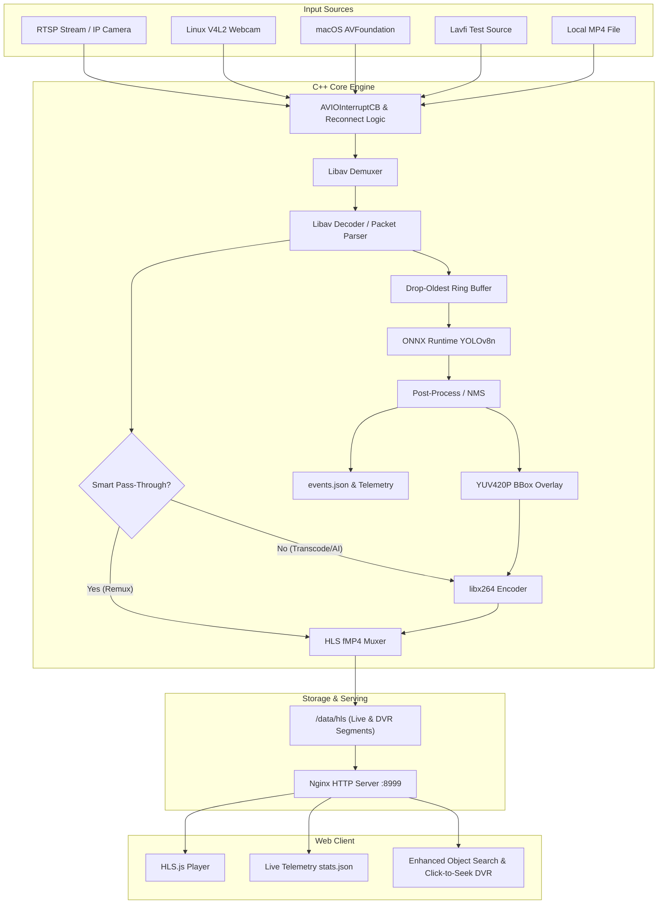

# High-Performance C++20 Live Video Streaming & AI Inference Solution

An end-to-end, pure C++20 **Libav** (`libavformat` / `libavcodec` / `libavdevice` / `libswscale`) live video streaming and edge AI inference engine. Designed for maximum throughput, zero reliance on external streaming servers (zero MediaMTX / zero SRS / zero RTMP daemons), robust network outage resilience, and real-time ONNX object detection with click-to-seek DVR playback.

---

## Table of Contents
1. [Overview & Key Features](#1-overview--key-features)
2. [Architecture Diagram](#2-architecture-diagram)
3. [Quick Start (Docker Compose)](#3-quick-start-docker-compose--1-command)
4. [Native Build & Run (Meson)](#4-native-build--run-meson--macos--ubuntudebian)
5. [Configuration Reference (`.env`)](#5-configuration-reference-env)
6. [Testing, Sanitizers & Chaos Verification](#6-testing-sanitizers--chaos-verification)
7. [Profiling & Performance Results](#7-profiling--performance-results)

---

## 1. Overview & Key Features

- **Pure C++20 Libav Pipeline**: Direct socket and packet handling using FFmpeg/Libav APIs (`avformat_open_input`, `avcodec_send_packet`, `avcodec_receive_frame`, `av_interleaved_write_frame`). No heavy intermediary streaming daemons.
- **Smart Pass-Through vs. Transcoding**:
  - *Smart Pass-Through*: Zero-copy H.264/HEVC remuxing (`TRANSCODE_MODE=remux` or `auto`) for minimal CPU usage ($\approx 0.1\,\text{ms}$ frame latency).
  - *Conditional Transcoding*: Automatic fallback to `libx264` (`preset=ultrafast`) when input codecs require normalization or when AI object overlays are injected.
- **Dual HLS Stream Architecture**:
  - **Shared-segment Live (`live.m3u8`)**: Rolling window (`HLS_LIVE_LIST_SIZE=5`, `HLS_SEGMENT_DURATION=2s`) optimized for ultra-low latency playback.
  - **Rolling DVR Playback (`playback.m3u8`)**: Long-term retention (`PLAYBACK_RETENTION_SEC=1800`) with safe background pruning.
- **Two-Sided Network Outage Resilience**:
  - *Upstream*: `AVIOInterruptCB` watchdogs combined with exponential backoff (`RECONNECT_BASE_MS=1000`, `RECONNECT_MAX_MS=30000`) and `#EXT-X-DISCONTINUITY` insertion upon stream drops.
  - *Downstream*: HLS.js robust auto-recovery handlers for `NETWORK_ERROR` and `MEDIA_ERROR`.
- **Local AI Object Detection & Enhanced Search**:
  - ONNX Runtime C++ inference using YOLOv8n (320px input).
  - Ring buffer drop-oldest concurrency, pooled YUV/RGB buffers, and direct YUV420P bounding box overlay (no RGB roundtrip).
  - **Enhanced Object Search**: Filter events by classes (e.g. `person, car` with `AND`/`OR` logic) and click-to-seek DVR playback via generated `events.json` telemetry.
- **Web Player & Telemetry**:
  - Modern web dashboard at `http://localhost:8999` with real-time read-only live telemetry status bar (`stats.json`).

---

## 2. Architecture Diagram



---

## 3. Quick Start (Docker Compose — 1 Command)

Ensure Docker and Docker Compose are installed, then run:

```bash
# 1. Copy environment template
cp .env.example .env

# 2. Export YOLOv8n ONNX model (or set AI_ENABLED=false / SYNTHETIC_DETECTIONS=true in .env)
python3 scripts/export_yolov8n.py --imgsz 320 --output models/yolov8n_320.onnx

# 3. Build and launch containers
docker compose up --build
```

Open your browser at **`http://localhost:8999`**.

---

## 4. Native Build & Run (Meson — macOS & Ubuntu/Debian)

### Dependencies
- **macOS (Homebrew)**:
  ```bash
  brew install meson ninja ffmpeg onnxruntime pkg-config
  ```
- **Ubuntu / Debian**:
  ```bash
  sudo apt-get update && sudo apt-get install -y meson ninja-build libavformat-dev libavcodec-dev libavutil-dev libavdevice-dev libswscale-dev libonnxruntime-dev pkg-config
  ```

### Build & Test
```bash
# Setup build directory
meson setup build --buildtype=debugoptimized

# Compile
meson compile -C build

# Run Unit Tests
meson test -C build --print-errorlogs
```

### Running Natively
Set your desired source type in `.env` (or environment variables) and run the binary:
```bash
# Example with lavfi test source or local file
SOURCE_TYPE=lavfi SOURCE_URL="testsrc=size=1280x720:rate=30" ./build/live_streamer
```
To serve the web interface and HLS output locally without Docker, point Nginx or a static file server to `web/` and set `HLS_OUTPUT_DIR=hls_out`.

---

## 5. Configuration Reference (`.env`)

Every variable defined in `.env.example` is detailed below:

| Variable | Default | Description |
| :--- | :--- | :--- |
| `WEB_PORT` | `8999` | Nginx web dashboard listening port. |
| `HLS_OUTPUT_DIR` | `/data/hls` | Directory where HLS segments (`live.m3u8`, `playback.m3u8`) and JSON telemetry are written. |
| `SOURCE_TYPE` | `rtsp` | Input source type (`rtsp`, `v4l2`, `avfoundation`, `lavfi`, `file`). |
| `SOURCE_URL` | `rtsp://mock-camera:8554/live` | Stream URL, device index, or lavfi filter string. |
| `SOURCE_WIDTH` | `1280` | Input capture width in pixels. |
| `SOURCE_HEIGHT` | `720` | Input capture height in pixels. |
| `SOURCE_FPS` | `30` | Target capture framerate. |
| `TRANSCODE_MODE` | `auto` | Transcoding policy (`auto`, `always`, `remux`). |
| `ENCODER_PRESET` | `ultrafast` | libx264 encoder preset. |
| `ENCODER_BITRATE_KBPS` | `2000` | Target video encoding bitrate in Kbps. |
| `ENCODER_THREADS` | `2` | Number of encoder threads. |
| `HLS_SEGMENT_DURATION` | `2` | HLS segment duration in seconds. |
| `HLS_LIVE_LIST_SIZE` | `5` | Number of segments retained in `live.m3u8`. |
| `PLAYBACK_RETENTION_SEC` | `1800` | Rolling DVR retention window in seconds (30 minutes). |
| `AI_ENABLED` | `true` | Enable or disable local ONNX object detection. |
| `AI_MODEL_PATH` | `/app/models/yolov8n_320.onnx` | Path to YOLOv8n ONNX model weights. |
| `AI_CONF_THRESHOLD` | `0.45` | Object detection confidence threshold. |
| `AI_THREADS` | `2` | ONNX Runtime execution thread count. |
| `AI_TARGET_CLASSES` | `person,car,truck,bicycle` | Comma-separated list of target classes to detect & index. |
| `AI_SYNC_MODE` | `false` | Run inference synchronously vs. async ring-buffer drop-oldest. |
| `USE_BUFFER_POOL` | `true` | Use memory pool for frame allocations. |
| `SYNTHETIC_DETECTIONS` | `false` | Fallback to synthetic bounding boxes if ONNX model is absent. |
| `MAX_DURATION_SEC` | `0` | Auto-terminate after N seconds (0 = run indefinitely). |
| `READ_TIMEOUT_MS` | `5000` | AVIO interrupt timeout threshold in milliseconds. |
| `RECONNECT_BASE_MS` | `1000` | Initial exponential backoff delay on disconnect. |
| `RECONNECT_MAX_MS` | `30000` | Maximum exponential backoff delay limit. |
| `PROFILING_LOG_INTERVAL_SEC` | `5` | Interval for updating `stats.json` and metrics. |

---

## 6. Testing, Sanitizers & Chaos Verification

### Unit & Integration Tests
```bash
meson test -C build --print-errorlogs
```

### AddressSanitizer (ASan) Memory Safety Verification
```bash
meson setup build_asan --buildtype=debugoptimized -Db_sanitize=address
meson compile -C build_asan
meson test -C build_asan --print-errorlogs
```

### Chaos Outage & Reconnect Test
Verify resilience against sudden TCP/network drops:
```bash
# Local mode chaos test
./tests/chaos_outage.sh --mode local

# Docker container chaos test
./tests/chaos_outage.sh --mode docker
```

---

## 7. Profiling & Performance Results

Performance benchmarks measured at **1280×720 @ 30fps** under various pipeline configurations (from [docs/profiling/latest_results.json](docs/profiling/latest_results.json)):

| Pipeline Mode | Frames Processed | AI Inferences | Effective FPS | Decode Avg / P95 (ms) | Inference Avg / P95 (ms) | Encode Avg / P95 (ms) | Total Latency Avg / P95 (ms) | Peak RSS (MB) |
| :--- | :---: | :---: | :---: | :---: | :---: | :---: | :---: | :---: |
| **Baseline** | 365 | 365 | 30.54 | 0.001 / 0.005 | 0.310 / 0.529 | 1.218 / 1.991 | **4.009 / 5.932** | 40.64 |
| **Optimized** | 365 | 365 | 30.16 | 0.002 / 0.006 | 0.238 / 0.352 | 2.518 / 3.898 | **3.150 / 5.026** | 46.39 |
| **Smart Remux** | 365 | 0 | 30.24 | 0.000 / 0.000 | 0.000 / 0.000 | 0.099 / 0.023 | **0.099 / 0.023** | **23.72** |

For an in-depth analysis of memory pooling, ring-buffer threading models, and hardware acceleration, refer to:
- [Benchmark Report](docs/profiling/benchmark_report.md)
- [Design Specification](docs/DESIGN.md)
