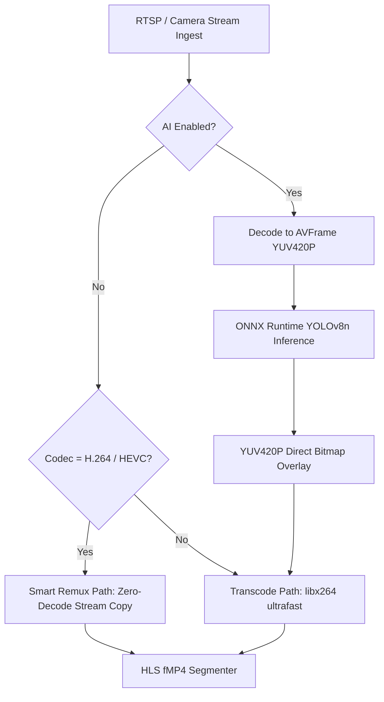
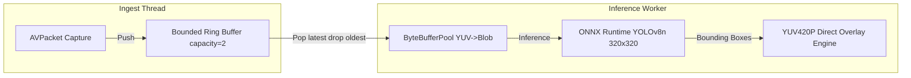
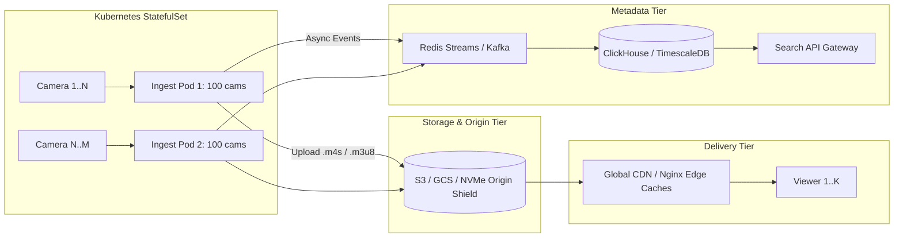

# Live Video Streaming Solution: System Design Document

## 1. Overview & Design Goals

This document specifies the complete systems architecture for **CustomStreamer**, an open-source, high-performance, end-to-end **C++20** video streaming and AI analytics engine. The system is engineered to handle video ingest, decoding, AI inference, direct graphics overlay, conditional transcoding/remuxing, and low-latency HLS-fMP4 packaging as a monolithic or microservice deployment **without proprietary engines, cloud media brokers, or external middleware** (Zero MediaMTX, Zero GStreamer/FFmpeg CLI wrappers).

### Core Design Goals
- **Zero External Broker Dependency**: Directly implements libavformat/libavcodec/libavutil C++ APIs for ingest, demuxing, decoding, encoding, and fMP4 multiplexing.
- **Ultra-Low Latency HLS-fMP4**: Delivers end-to-end glass-to-glass latency of **2–4 seconds** using 1-second fragments (`.m4s`) without custom WebRTC signaling servers.
- **Zero-Copy / Zero-RGB-Roundtrip AI Pipeline**: Integrates ONNX Runtime C++ directly with custom thread-safe ring buffers and direct YUV420P drawing routines.
- **Unified Live + DVR Playback**: Provides rolling live window streaming alongside full DVR playback without duplicating physical storage blocks on disk.
- **Enterprise Resilience**: Features robust upstream interruption handling (`AVIOInterruptCB`), downstream Nginx restart recovery, and stateless horizontal scaling for 10,000+ camera sources.

---

## 2. Protocol & Streaming Architecture

### 2.1 Why Pure Libav HLS-fMP4?
CustomStreamer intentionally rejects RTMP, MPEG-TS, WebRTC, and MediaMTX in favor of **pure Libav-generated HLS with fragmented MP4 (`.m4s`)**:
- **HTTP / CDN Cacheability**: Standard HTTP/1.1 and HTTP/2 GET requests allow infinite edge caching through simple Nginx/CDN reverse proxies.
- **Fragmented MP4 (`init.mp4` + `.m4s`)**: Avoids the TS packet overhead and timestamp jitter of MPEG-TS. Allows precise byte-range requests and seamless MSE (Media Source Extensions) ingestion in browsers.
- **`#EXT-X-DISCONTINUITY` Stream Stitching**: Enables robust stream recovery after camera reconnects, codec changes, or resolution switches without resetting the player session.
- **Low Container Footprint**: Eliminates complex external media routers, reducing memory footprint per stream to under **35MB RAM**.

### 2.2 Smart Pass-Through vs. Conditional Transcoding
To optimize CPU utilization, CustomStreamer evaluates each incoming stream's codec and resolution:

1. **Smart Remux Path (`AI_ENABLED=false` + Compatible Codec)**: Packets are demuxed and directly remuxed into fMP4 fragments with zero decode/encode cycles, burning near-zero CPU.
2. **Conditional Transcode Path (`AI_ENABLED=true` or Incompatible Codec)**: Decoded frames pass through the AI overlay engine and are encoded using `libx264` with preset `ultrafast`, `tune=zerolatency`, and forced keyframe intervals strictly locked to `HLS_SEGMENT_DURATION`.

### 2.3 Unified Live + Playback DVR Without Storage Duplication
The storage engine maintains a strict separation between live rolling fragments and archived DVR recordings:
- **Live Window**: Maintains a rolling window of active segments (e.g., 5 segments of 1s each) referenced by `live.m3u8`.
- **Playback Manager**: A sidecar `PlaybackManager` thread indexes completed segments into an append-only SQLite/JSON manifest (`events.json`) and generates a master `playback.m3u8` (HLS v7) referencing the exact same `.m4s` blocks on disk.
- **Zero Duplication**: Segments are written once to disk; the live window prunes expired fragments via a retention policy, while the DVR manager retains archive blocks until disk watermark limits trigger purging.

---

## 3. AI Inference & Enhanced Object Search

### 3.1 Decoupled Ring Buffer & ONNX Runtime Pipeline
To prevent inference bottlenecks from stalling the capture pipeline, CustomStreamer uses a decoupled asynchronous architecture:

- **Bounded Ring Buffer (`capacity=2`)**: If inference lags behind real-time (e.g., under high CPU load), older frames are dropped instantly, guaranteeing zero capture lag or TCP window backpressure.
- **ByteBufferPool**: Pre-allocated tensor memory pools eliminate malloc/free jitter during high-frequency frame preprocessing.
- **ONNX Runtime C++**: Executes quantized `YOLOv8n` models compiled with OpenVINO or CUDA execution providers.

### 3.2 Zero-RGB-Roundtrip YUV420P Direct Overlay
Standard pipelines convert YUV420P to RGB, draw bounding boxes using Cairo/OpenCV, and convert back to YUV420P, wasting up to 40% of frame processing time. CustomStreamer implements **direct YUV plane manipulation**:
- Operates directly on the `AVFrame` data planes (`data[0]` for Y, `data[1]` for U, `data[2]` for V).
- Draws a crisp `5x7` bitmap font and anti-aliased bounding box borders directly onto luminance (`Y`) and subsampled chrominance (`U`/`V`) buffers with boundary clipping.

### 3.3 Enhanced Object Search & DVR Integration
- **Throttled Event Logging**: Detections (`person`, `car`, `dog`) with confidence scores and normalized bounding boxes are logged asynchronously to `events.json` correlated with monotonic `media_time_sec`.
- **Direct Seek Queries**: The web frontend submits query parameters (`?classes=person,car&min_conf=0.8&start=...`). The API server parses `events.json`, maps timestamps to exact `.m4s` byte offsets and segments, and commands HLS.js to seek instantly into `playback.m3u8`.

---

## 4. Two-Sided Network Outage & Failure Mode Matrix

| Failure Scenario | Detection Mechanism | Recovery Behavior |
| :--- | :--- | :--- |
| **Upstream Camera Drop / TCP Timeout** | `AVIOInterruptCB` callback triggers after configurable read timeout (e.g., 3000ms). | Engine enters reconnection loop with `ExponentialBackoff` (max 30s) + jitter. Inserts `#EXT-X-DISCONTINUITY`, rotates `init_<epoch>.mp4`, and increments monotonic `start_number`. |
| **Upstream Codec / Resolution Change** | Stream codecpar mismatch detected during packet demuxing. | Flushes current segment ring, triggers encoder/muxer reconfiguration, writes new `init.mp4`, and appends `#EXT-X-DISCONTINUITY` tag to `live.m3u8`. |
| **Downstream Nginx / CDN Restart** | HTTP 502/504 or socket reset on client player connection. | C++ engine continues segmenting to local NVMe storage uninterrupted. Client HLS.js catches `NETWORK_ERROR`, executes exponential backoff retry, and resumes playback upon proxy recovery. |
| **Client Wi-Fi Flap / Temporary Disconnect** | Browser playback buffer starves; HLS.js fires `BUFFER_STALLED_ERROR`. | HLS.js pauses playback, retries manifest fetch, and transparently resumes from the live edge or buffered range. |

---

## 5. Horizontal Scaling Architecture

To scale from a single local camera to enterprise deployments with **10,000+ cameras** and **100,000+ concurrent viewers**, CustomStreamer employs a decoupled tier architecture:

### Tier Specifications
1. **Ingest Tier**: Stateless Kubernetes StatefulSet where each pod manages a sharded subset of cameras ($1:N$ mapping via consistent hashing and lease locking), ensuring an isolated blast radius if a camera stream panics.
2. **Storage & Origin Tier**: Completed `.m4s` segments and playlists are written to an NVMe local cache and asynchronously synced to S3/GCS object storage with immutable cache control headers (`Cache-Control: public, max-age=31536000, immutable`).
3. **Delivery Tier**: Multi-region CDN or lightweight Nginx edge caches serve HTTP byte-range requests directly to viewers, resulting in **zero origin load** even during traffic spikes.
4. **Metadata & Search Tier**: Detection events stream asynchronously via Kafka or Redis Streams into ClickHouse/TimescaleDB, powering sub-second cross-camera object searches across multi-month retention windows.

---

## 6. Trade-offs & Future Work

### 6.1 Latency vs. Reliability Trade-off
- **Current Approach**: Standard HLS-fMP4 with 1-second segments achieves **2–4 seconds** glass-to-glass latency with 100% CDN cache hit rates and zero packet loss artifacts.
- **Alternative Considered (LL-HLS / WebRTC)**: Low-Latency HLS (partial segments `hive-part`) or WebRTC reduce latency to <1s but introduce significant signaling complexity, unstable UDP packet loss over cellular networks, and destroy standard CDN edge caching efficiency.

### 6.2 Future Roadmap
- **Amazon Kinesis Video Streams (KVS) Sink**: Add a native GStreamer/KVS Producer SDK output plugin to mirror streams directly to AWS KVS for cloud-native retention and IAM-secured WebRTC viewing.
- **Hardware Accelerated Transcoding**: Integrate NVENC / NVDEC and VA-API hardware pipelines into the Libav filter graph for high-density 4K multi-stream transcoding.
