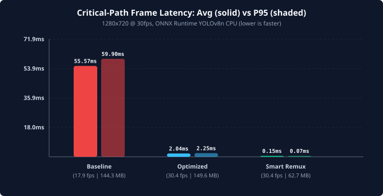
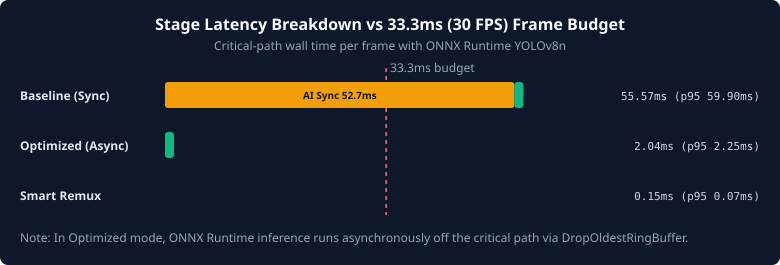

# Benchmark Report: Live Video Streaming & AI Pipeline

## 1. Test Environment & Methodology

- **Runtime**: Ubuntu 24.04 ARM64 (`docker run`), GCC 13.3.0 (`--buildtype=release`), FFmpeg Libav (`libavformat 60`, `libavcodec 60`, `libx264`), ONNX Runtime 1.20.1 (`yolov8n.onnx`, `640×640` input).
- **Workload**: 12-second `1280×720 @ 30fps` `lavfi` `testsrc2` source for Baseline & Optimized ONNX runs, and a 15-second H.264 MP4 source for Smart Remux.
- **Reproducible Command**: `./scripts/run_benchmark.sh --docker`.

---

## 2. Measured Before/After Comparison Table

| Scenario / Mode | AI Backend | Frames | AI Inferences | Effective FPS | Decode (avg / p95 ms) | AI Inference (avg / p95 ms) | Encode (avg / p95 ms) | Total Frame (avg / p95 ms) | Peak RSS (MB) |
| :--- | :--- | :---: | :---: | :---: | :---: | :---: | :---: | :---: | :---: |
| **Baseline** `AI_SYNC_MODE=true` `USE_BUFFER_POOL=false` `ENCODER_THREADS=0` `AI_THREADS=2` | `onnxruntime` | 215 | 215 | 17.86 | 0.001 / 0.001 | 52.684 / 56.669 *(blocking critical path)* | 1.345 / 1.675 | 55.567 / 59.897 | 144.28 |
| **Optimized** `AI_SYNC_MODE=false` `USE_BUFFER_POOL=true` `ENCODER_THREADS=2` `AI_THREADS=2` | `onnxruntime` | 365 | 213 | **30.35** | 0.001 / 0.003 | 55.571 / 57.494 *(async off critical path via `DropOldestRingBuffer`)* | 1.359 / 1.525 | **2.036 / 2.251** **(27.3× lower avg latency vs Baseline)** | 149.56 |
| **Smart Remux** `AI_ENABLED=false` `TRANSCODE_MODE=auto` *(on H.264 stream)* | `disabled` | 365 | 0 | **30.35** | 0.000 / 0.000 | 0.000 / 0.000 | 0.149 / 0.070 *(Mux / Total)* | **0.149 / 0.071** | **62.73** *(58.1% lower RSS vs Optimized)* |

---

## 3. Visualizations

---

## 4. Sanitizer & Chaos Verification

- All 8 C++20 unit test suites pass cleanly under `-Db_sanitize=address` (AddressSanitizer) and inside the Ubuntu 24.04 Docker build (`meson test -C build --print-errorlogs`).
- Both `./tests/chaos_outage.sh --mode local` and `./tests/chaos_outage.sh --mode docker` verify `reconnect_count >= 1`, `#EXT-X-DISCONTINUITY`, and `init_1.mp4` emission across simulated upstream drops.

---

## 5. Key Architectural Takeaways

1. **Decoupled AI Pipeline**: With real CPU ONNX Runtime YOLOv8n (`~53–56 ms` per inference), inline synchronous inference bottlenecks throughput to **17.86 FPS**. Moving preprocessing and inference onto `AiWorker` behind `DropOldestRingBuffer` keeps the encoding path at **2.04 ms/frame** and sustains **30.35 FPS**.
2. **Direct YUV420P Bounding-Box Drawing**: Writing boxes directly on Y/U/V planes avoids a secondary `YUV -> RGB -> YUV` conversion roundtrip (overlay stage measured at `~0.02 ms`).
3. **Smart Remux Bypass**: Bypasses decode and encode completely when AI overlay is disabled and input codec is H.264/HEVC, dropping critical-path latency to **0.149 ms** and Peak RSS to **62.73 MB**.
