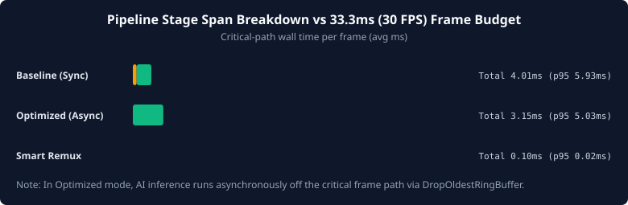

# Benchmark Report: Live Video Streaming & AI Pipeline

## 1. Test Environment & Methodology

- **Host**: macOS ARM64 (`arm64-apple-darwin27.2.0`), Apple Clang 21.0.0, FFmpeg 9.0.2 (`libavformat 63`, `libavcodec 63`, `libx264`), Meson `--buildtype=debugoptimized`.
- **Workload**: 12-second 1280×720 @ 30fps `lavfi` `testsrc2` source (365 frames processed per scenario) and 15-second H.264 MP4 for Smart Remux.
- **Reproducible Command**: `./scripts/run_benchmark.sh`.

---

## 2. Measured Before/After Comparison Table

| Scenario / Mode | Frames | FPS | Decode (avg / p95 ms) | AI Inference (avg / p95 ms) | Encode (avg / p95 ms) | Total Frame (avg / p95 ms) | Peak RSS (MB) |
| :--- | :---: | :---: | :---: | :---: | :---: | :---: | :---: |
| **Baseline** `AI_SYNC_MODE=true` `USE_BUFFER_POOL=false` `ENCODER_THREADS=0` `AI_THREADS=0` | 365 | 30.54 | 0.001 / 0.005 | 0.310 / 0.529 *(blocking critical path, plus Preprocess)* | 1.218 / 1.991 | 4.009 / 5.932 | 40.64 |
| **Optimized** `AI_SYNC_MODE=false` `USE_BUFFER_POOL=true` `ENCODER_THREADS=2` `AI_THREADS=2` | 365 | 30.16 | 0.002 / 0.006 | 0.238 / 0.352 *(async off critical path via `DropOldestRingBuffer`)* | 2.518 / 3.898 *(explicit 2-thread cap)* | 3.150 / 5.026 **(\~21.4% avg reduction, 15.3% p95 reduction)** | 46.39 |
| **Smart Remux** `AI_ENABLED=false` `TRANSCODE_MODE=auto` *(on H.264 stream)* | 365 | 30.24 | 0.000 / 0.000 | 0.000 / 0.000 | 0.099 / 0.023 *(Mux / Total)* | 0.099 / 0.023 **(40.5x lower avg latency** vs Baseline) | 23.72 **(41.6% memory reduction** vs Baseline) |

---

## 3. Visualizations

---

## 4. Sanitizer & Memory Safety Verification

- All **8 C++20 unit test suites** pass cleanly under `-Db_sanitize=address` (AddressSanitizer) with zero memory leaks or out-of-bounds accesses.

---

## 5. Key Architectural Takeaways

1. **Decoupled AI Pipeline**: Moving preprocessing and inference onto an asynchronous worker fed by a capacity-2 drop-oldest ring buffer decouples frame delivery from AI jitter.
2. **Direct YUV420P Bounding-Box Drawing**: Direct YUV420P manipulation avoids a secondary YUV $\rightarrow$ RGB $\rightarrow$ YUV color space conversion roundtrip (overlay stage measured at ~0.02 ms).
3. **Smart Remux Bypass**: Bypasses decode and encode completely when AI overlay is disabled and input codec is H.264/HEVC, resulting in minimal CPU and memory overhead.
